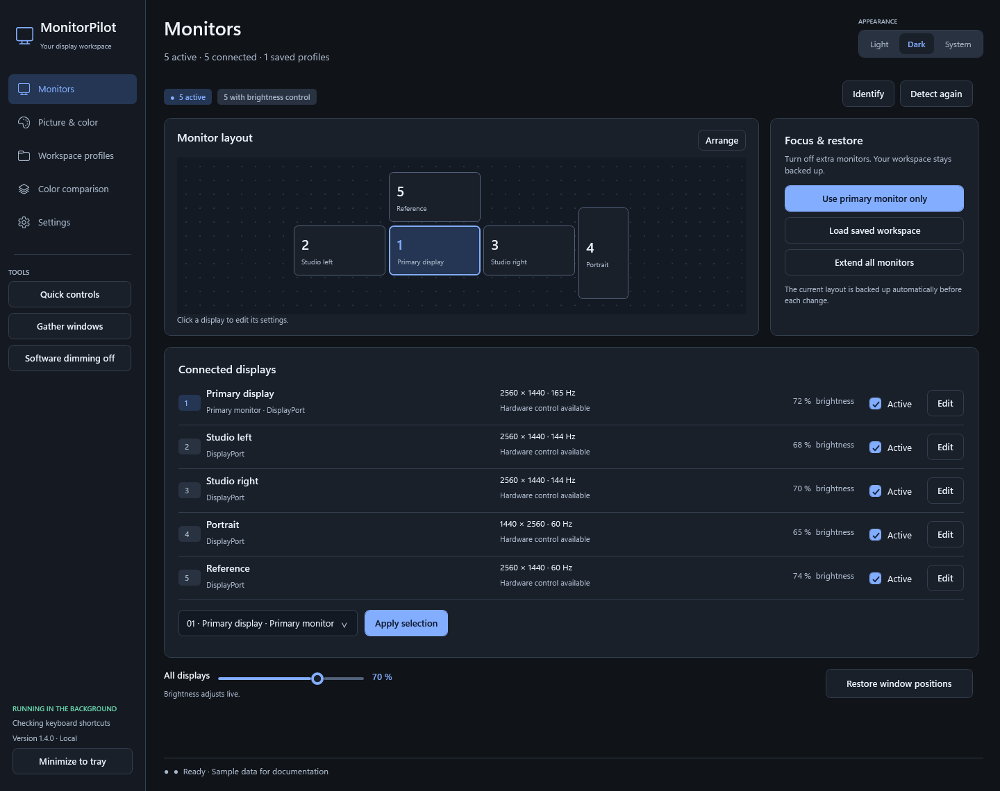
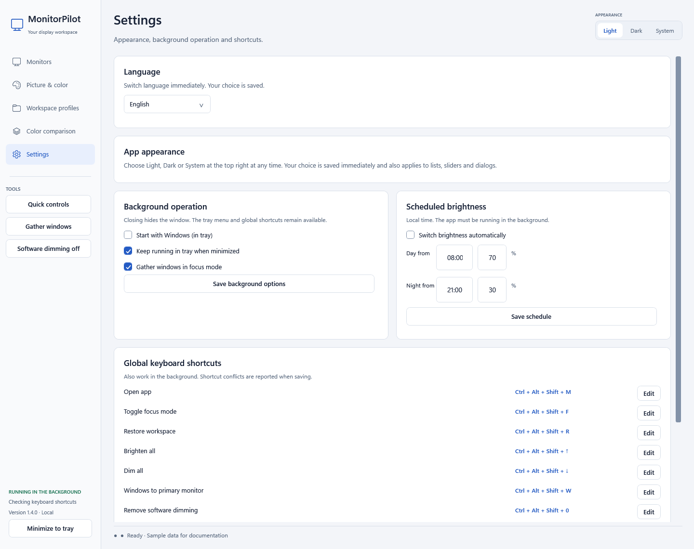
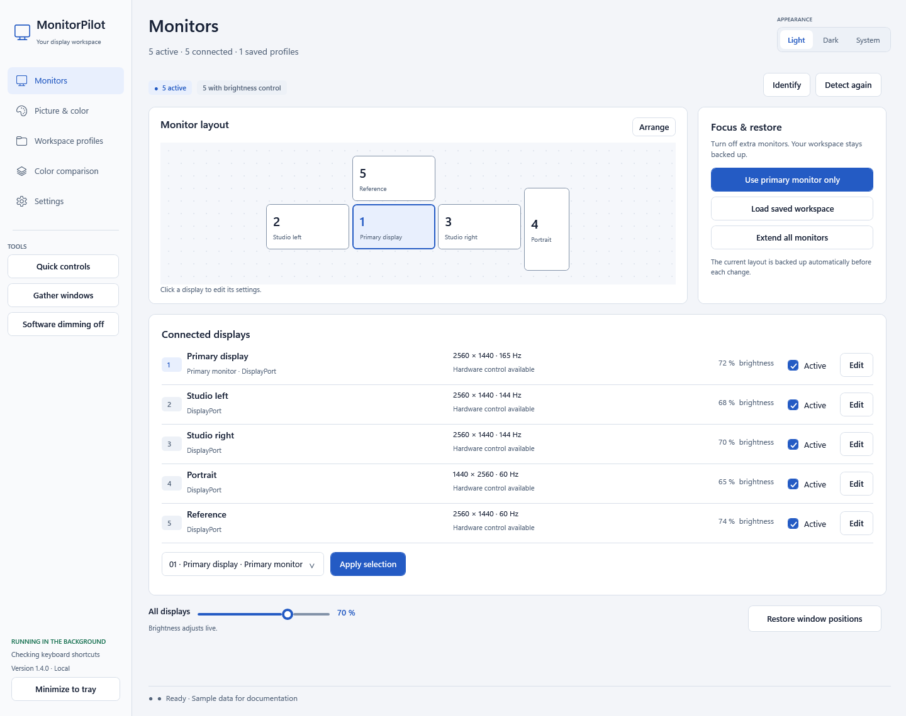
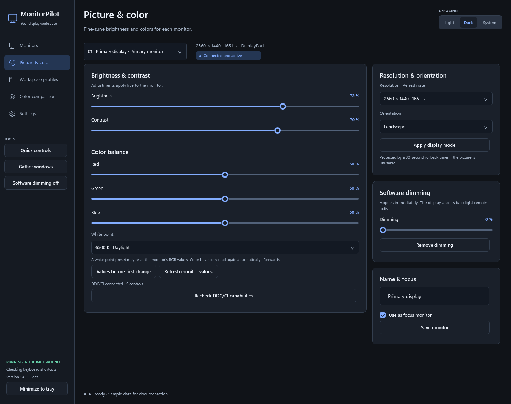
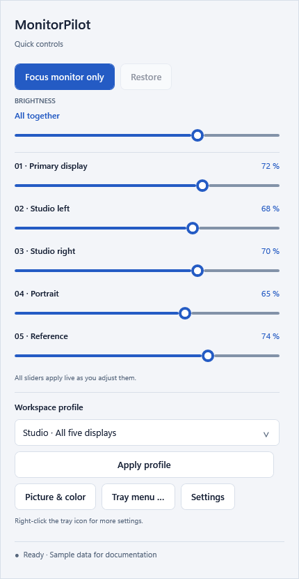

<p align="center"></p>
<h1 align="center">MonitorPilot</h1>
<p align="center"><strong>Your displays. Your workspace. One cockpit.</strong></p>
<p align="center">Live monitor controls, a useful tray, and a workspace you can bring back.</p>

<p align="center">
<a href="https://github.com/devdiyar/MonitorPilot/actions/workflows/build.yml"></a>
<a href="https://github.com/devdiyar/MonitorPilot/releases/latest"></a>
<a href="LICENSE"></a>


</p>

<p align="center"><a href="https://github.com/devdiyar/MonitorPilot/releases/latest"><strong>Download</strong></a> · <a href="docs/README.de.md">Deutsch</a> · <a href="docs/COMPATIBILITY.md">Compatibility</a> · <a href="https://github.com/devdiyar/MonitorPilot/issues">Report an issue</a></p>



MonitorPilot is a free, native Windows app for people who work with several monitors. Adjust brightness and color while moving the sliders, switch to a single focus display, and restore your saved display layout and the positions of still-open windows. It runs in the notification area, so controls stay close when the main window is closed.

The app supports **Deutsch and English**. Switch instantly under **Settings → Language** or **right-click the tray icon → Language**. Your choice is saved; existing installations stay German until you choose English. The images show the actual WPF interface rendered with anonymous example data.

<details>
<summary><strong>Choose your language</strong></summary>



</details>

## Get started

1. Download the latest [release](https://github.com/devdiyar/MonitorPilot/releases/latest).
2. For installation, extract **MonitorPilot-Setup-win-x64.zip** and run **MonitorPilot-Setup.exe**. For use without installation, extract **MonitorPilot-Portable-win-x64.zip** and run **MonitorPilot.exe**.
3. Enable **DDC/CI** in the external monitor's own settings if hardware controls are unavailable.
4. Move a brightness or color slider. Changes apply live; there is no separate brightness/color Apply button.
5. Save a **workspace profile** before setting up a focus workspace. Use **Restore workspace** to bring the saved workspace back.

The executable includes the .NET runtime. No separate .NET installation, account, administrator privileges, or cloud service is required. The installer creates Start menu and desktop shortcuts and an entry in Windows' installed apps. Autostart is opt-in. Builds are currently **unsigned**; download them from this repository's Releases page. Releases include SHA-256 checksums.

Target: Windows 10/11 **x64**. Windows 11 with five physical monitors is the tested configuration. Windows 10 and other monitor/adapter combinations need further device testing. Read the [compatibility notes](docs/COMPATIBILITY.md), including the runtime's Windows support policy.

## What you can do

| Feature | Behavior |
| --- | --- |
| **Live picture controls** | Brightness, contrast, RGB gain, and supported white-point presets through DDC/CI; final values are read back from the monitor. |
| **Tray quick control** | Live sliders for every active display, a master brightness slider, focus/restore, and saved profiles. |
| **Tray menu** | Monitor selection, brightness presets, dimming, supported white points, profiles, window tools, themes, language selection, autostart, schedules, and standby. |
| **Focus mode** | Save the workspace, optionally collect open windows, and deactivate the extra displays in Windows. |
| **Workspace restore** | Restore display configuration, still-open windows, readable monitor controls, and software dimming. |
| **Display configuration** | Active displays, main/focus display, desktop positions, resolution, refresh rate, and rotation. |
| **Return protection** | An independent process restores the previous layout and open-window positions if a display change is not confirmed within about 30 seconds. |
| **Picture comparison** | Shared grayscale, color patches, and full-color test images, plus shortcuts to Windows color tools. |
| **Software dimming** | A live, click-through black overlay per display, from 0 to 80%; useful when hardware brightness is unavailable. |
| **Everyday convenience** | Light/dark/system themes, display aliases, editable global hotkeys, opt-in startup, day/evening brightness schedules, and hotplug refresh. |
| **Local data** | JSON profile import/export, original hardware values, recovery snapshots, diagnostics, and an activity log. |

Layout and resolution changes keep an explicit confirmation step because they can move windows or temporarily remove visible outputs. Brightness, contrast, RGB, white point, and dimming controls apply live.

## A closer look

<details>
<summary><strong>Light theme</strong></summary>



</details>

<details>
<summary><strong>Live brightness and color</strong></summary>



</details>

<details>
<summary><strong>Tray quick control</strong></summary>



</details>

## Focus now, restore later

Before a display switch, MonitorPilot saves the current workspace to disk. Focus mode uses the chosen focus display; open windows can be collected onto it. Confirm the layout in the return-protection dialog. Restore brings the saved displays back and applies saved window positions and available hardware values.

Snapshots include display positions, resolution, refresh rate, orientation, window placement and minimized/maximized state, readable brightness/contrast/RGB/white point, and dimming. Windows are matched by window handle, process ID, and process start time.

**Closed apps, documents, browser tabs, and new window instances are not reopened.** Missing monitors are checked before applying a saved configuration. **Alle Monitore erweitern** asks Windows for its extended layout; **Arbeitsplatz wiederherstellen** loads your saved layout.

## Keyboard shortcuts

The default modifiers are **Ctrl + Alt + Shift**. Shortcuts work in the background and can be changed in **Einstellungen**. Registration conflicts are reported.

| Additional key | Action |
| --- | --- |
| M | Open MonitorPilot |
| F | Toggle focus / restore |
| R | Restore workspace |
| ↑ / ↓ | Hardware brightness ±5 percentage points |
| W | Collect open windows onto the main display |
| 0 | Remove software dimming |

Left-click the tray icon for quick controls. Right-click for the full menu. Closing the main window keeps the app running; choose **Beenden** in the tray menu to exit completely.

## Monitor support and realistic expectations

Hardware controls depend on the monitor, its picture mode, cable/dock, and graphics driver. Unsupported controls are disabled individually. Internal laptop-panel brightness through WMI, monitor input switching, HDR switching, and automatic ICC-profile assignment are not implemented.

Equal brightness percentages are not equal luminance across models. RGB controls and test images support visual comparison; measured calibration requires a colorimeter and suitable ICC profiles. MonitorPilot does not replace Windows color management or modify gamma ramps.

Software dimming leaves the display and backlight active. Focus mode deactivates extra Windows display outputs, which can reduce graphics work on some systems. **No fixed CPU, GPU, or power saving is claimed.** DDC commands have monitor/driver latency even with a responsive UI.

Read [Compatibility & troubleshooting](docs/COMPATIBILITY.md), [Performance](docs/PERFORMANCE.md), and the [validation report](docs/PRUEFBERICHT.md) for the tested scope and limits.

## Data and privacy

App data is stored in `%LOCALAPPDATA%\MonitorPilot`; the installed program is in `%LOCALAPPDATA%\Programs\MonitorPilot`. The app has no app telemetry, online account, background network API, or automatic update downloader. Uninstall preserves profiles and recovery files. Updates preserve settings and keep one previous executable.

Exported profiles can contain display identifiers and window titles. Diagnostics can contain display identifiers. Review and redact exports and logs before posting them publicly. Damaged startup data is copied to a `.corrupt-… .bak` file before fallback data is saved.

## Build and contribute

On Windows with the [.NET 10 SDK](https://dotnet.microsoft.com/download/dotnet/10.0):

```powershell
git clone https://github.com/devdiyar/MonitorPilot.git
cd MonitorPilot
./scripts/build.ps1
```

This builds self-contained x64 executables and runs self-tests and WPF live-control tests against the published executable. Outputs are under `artifacts/`. `./scripts/build.ps1 -Install` updates the local installation. `./scripts/package.ps1` creates release ZIPs and checksums after a successful build.

For development:

```powershell
dotnet run --project src/MonitorPilot/MonitorPilot.csproj
```

See [CONTRIBUTING](CONTRIBUTING.md) for the source layout, test commands, and device reports. CI runs hardware-independent tests on Windows; physical monitor tests are separate opt-in checks.

## License

Source and documentation use the [MIT license](LICENSE). You may use, modify, distribute, and use them commercially while retaining the license and copyright notice. Bundled runtime components retain their [third-party notices](THIRD-PARTY-NOTICES.md).

The [roadmap](docs/FEATURE-IDEEN.md) lists proposals, not existing features. Contributions and reproducible monitor reports are welcome.
