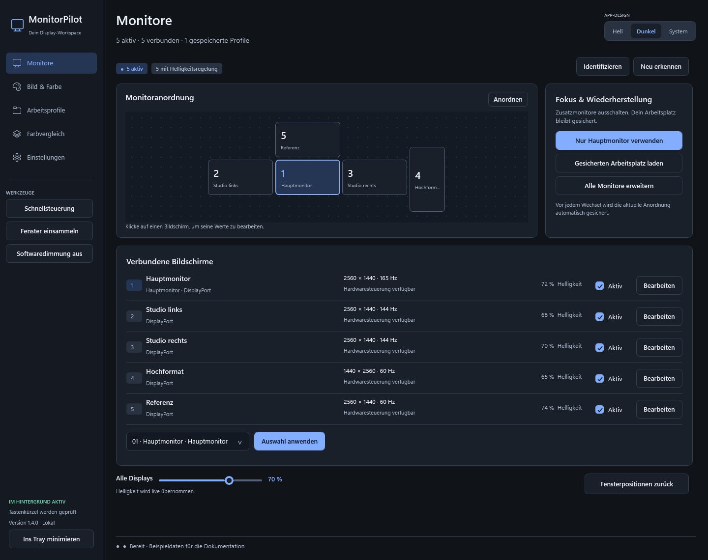

# MonitorPilot

**Deine Monitore. Dein Arbeitsplatz. Ein Cockpit.**

[Download](https://github.com/devdiyar/MonitorPilot/releases/latest) · [English](../README.md) · [Kompatibilität](COMPATIBILITY.md) · [Probleme melden](https://github.com/devdiyar/MonitorPilot/issues)

MonitorPilot ist eine kostenlose Windows-App für mehrere Monitore. Helligkeit, Kontrast, RGB, unterstützte Weißpunkt-Presets und Softwaredimmung wirken **live beim Verstellen**, auch im Tray. Du kannst Zusatzmonitore für den Fokusmodus deaktivieren und danach den gesicherten Arbeitsplatz zurückholen.

Die Bilder zeigen die echte Oberfläche mit anonymen Beispieldaten. Die App unterstützt **Deutsch und Englisch**. Unter **Einstellungen → Sprache** oder **Rechtsklick auf das Tray-Symbol → Sprache** wechselst du sofort, ohne Neustart. Die Auswahl wird gespeichert; bestehende Installationen bleiben zunächst auf Deutsch.

## Installieren und starten

1. Unter [Releases](https://github.com/devdiyar/MonitorPilot/releases/latest) **MonitorPilot-Setup-win-x64.zip** herunterladen, entpacken und **MonitorPilot-Setup.exe** starten. Ohne Installation: **MonitorPilot-Portable-win-x64.zip** entpacken und **MonitorPilot.exe** starten.
2. **DDC/CI im Bildschirmmenü aktivieren**. Nicht jeder Monitor, Bildmodus oder Adapter reicht alle Funktionen durch.
3. Oben rechts **Hell / Dunkel / System** wählen. Die Auswahl wirkt sofort und bleibt gespeichert.
4. Regler bewegen: Die App sendet den Zielwert im Hintergrund und liest den Monitor zurück. Dafür gibt es keinen zusätzlichen „Helligkeit anwenden“-/„Werte übernehmen“-Button.
5. Unter **Arbeitsprofile** den Arbeitsplatz sichern. **Nur Hauptmonitor verwenden** startet den Fokusmodus; die neue Bildschirmkonfiguration bestätigen. **Arbeitsplatz wiederherstellen** bringt den gesicherten Zustand zurück.

Die EXE enthält .NET. Kein Konto, separater .NET-Download oder Administratorzugriff nötig. Die Installation erfolgt pro Benutzer mit Verknüpfungen; Autostart ist standardmäßig aus. Builds sind derzeit nicht codesigniert. Releases dieses Repositories enthalten SHA-256-Prüfsummen.

## Was zurückkommt

Gesichert werden aktive Displays, Hauptmonitor, Anordnung, Auflösung, Hz, Ausrichtung, Fensterpositionen einschließlich Minimieren/Maximieren, lesbare Hardwarewerte und Dimmung. Vor jeder Umschaltung gibt es eine Festplattensicherung. Ohne Bestätigung stellt ein separater Prozess die vorherige Anordnung und offene Fenster nach etwa 30 Sekunden wieder her.

Fenster kommen zurück, solange dieselben Fenster und Prozesse existieren. Geschlossene Programme, Dokumente und Browser-Tabs werden nicht neu geöffnet. **Alle Monitore erweitern** verwendet die Windows-Anordnung; **Arbeitsplatz wiederherstellen** deine gespeicherte Anordnung. Andere Anschlüsse oder ersetzte Monitore können alte Profile ungültig machen.

## Tray und Hintergrund

Linksklick: Schnellsteuerung mit gemeinsamem Regler, Regler pro Monitor, Fokus/Wiederherstellung und Profilen. Rechtsklick: Monitore, Helligkeitsstufen, Dimmung, Weißpunkt, Fenster, Standby, Design, Sprache, Autostart und Zeitplan.

Das X versteckt das Hauptfenster. **Beenden** im Tray beendet die App und wartet auf ausstehende Live-Änderungen. Standardkürzel: **Strg + Alt + Umschalt** plus M (öffnen), F (Fokus), R (Wiederherstellung), Pfeil hoch/runter (±5 %), W (Fenster sammeln), 0 (Dimmung entfernen). Kürzel sind änderbar; Konflikte werden angezeigt.

## Unterstützung und Grenzen

Ziel: Windows 10/11 x64 und unterschiedliche Monitore. Physisch geprüft: Windows 11 mit fünf externen Displays über Intel- und NVIDIA-Grafik. Windows 10 und weitere Modelle sind noch nicht an eigenen Prüfgeräten bestätigt. Die [Kompatibilitätsübersicht](COMPATIBILITY.md) erklärt auch die .NET-Unterstützung.

Hardware hängt von DDC/CI, Bildmodus, Kabel, Dock und Treiber ab. Unverfügbare Regler sind deaktiviert. Notebook-Helligkeit über WMI, ICC-Zuordnung, HDR-Umschalten und Monitor-Eingangswechsel sind noch nicht implementiert. Softwaredimmung ist eine Überlagerung und verändert keine Hintergrundbeleuchtung. Gleiche Prozente bedeuten keine gleiche Leuchtdichte; präzise Kalibrierung benötigt Colorimeter und ICC-Profile.

Fokusmodus kann Grafikarbeit reduzieren. Eine konkrete CPU-/GPU-/Stromersparnis wurde nicht gemessen und wird nicht versprochen. Layout-/Auflösungswechsel bleiben bewusste Aktionen mit Rückkehrschutz; Bildregler sind live.

## Daten und Lizenz

Daten: `%LOCALAPPDATA%\MonitorPilot`. Installation: `%LOCALAPPDATA%\Programs\MonitorPilot`. Updates und Deinstallation erhalten Profile/Sicherungen. Keine eigene Telemetrie, Cloud-Anbindung oder automatische Update-Abfrage. Defekte Startdateien werden vor Wiederherstellung als `.corrupt-… .bak` gesichert.

Profile können Fenstertitel und Monitoridentitäten enthalten; Diagnosen Monitoridentitäten. Vor öffentlichem Teilen private Daten entfernen.

Die [MIT-Lizenz](../LICENSE) erlaubt private/kommerzielle Nutzung, Änderung und Weitergabe mit Lizenz-/Urheberhinweisen. Laufzeitkomponenten behalten [eigene Hinweise](../THIRD-PARTY-NOTICES.md).

[Prüfbericht](PRUEFBERICHT.md) · [Leistungsmessungen](PERFORMANCE.md) · [Mitentwickeln](../CONTRIBUTING.md) · [Feature-Ideen](FEATURE-IDEEN.md)
